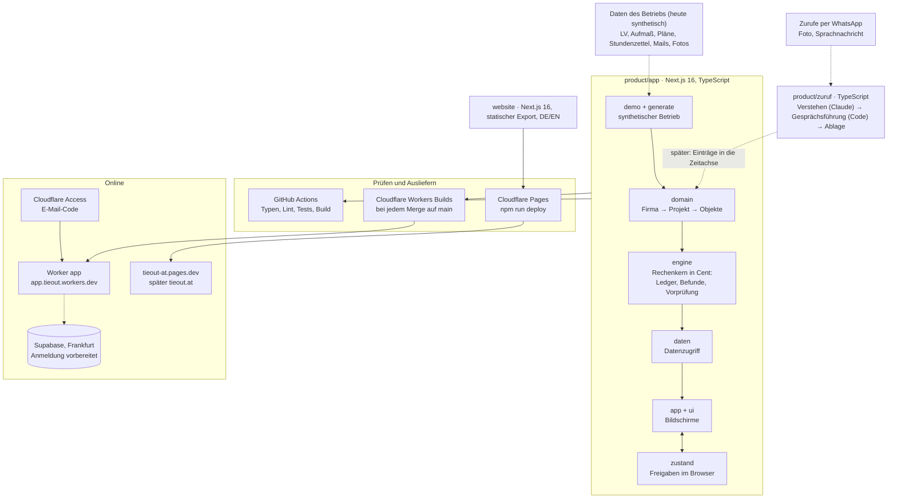

<p align="center">
  
</p>

<h1 align="center">tieout</h1>

<p align="center">
  <b>Der digitale Zwilling für Elektro- und HKLS-Betriebe. Erste Anwendung: die Schlussrechnung.</b><br />
  Hackathon-Projekt an der WU Wien, Open Track ([[PLATZHALTER: genauer Name des Hackathons]])
</p>

<p align="center">
  <a href="https://tieout-at.pages.dev">Website</a> ·
  <a href="https://app.tieout.workers.dev">Demo-App</a> (geschützt) ·
  <a href="https://www.linkedin.com/company/tieout-at/">LinkedIn</a> ·
  <a href="docs/dossier-v3.md">Dossier v3</a>
</p>

---

## Worum es geht

Auf der Baustelle wird oft mehr gebaut, geändert und zugerufen, als am Ende in der Schlussrechnung steht: Stundenarbeit ohne Unterschrift, Mehrmengen, Änderungen per Mail oder WhatsApp. Die Belege liegen verstreut in Postfächern, Plänen, Fotos und Köpfen. Gleichzeitig prüfen Auftraggeber Rechnungen mit Software und kürzen, was nicht belegt ist.

**tieout** führt alles, was ein Betrieb weiß, in einem **digitalen Zwilling** zusammen: oben der Betrieb (Auftraggeber, Verträge, Preisbasis, alle Projekte), darunter jedes Projekt bis zur einzelnen Position mit ihren Belegen. Die erste Anwendung darauf ist die **Schlussrechnung**: tieout gleicht ab, was beauftragt, gebaut und verrechnet wurde, und findet, was fehlt. Jede Position mit Beleg.

**Prinzipien**

- Die KI liefert Fakten mit Quelle, der Mensch bestätigt.
- Die Rechnung selbst ist deterministischer Code, keine Schätzung.
- Jede Zahl führt per Klick zum Original.
- Der Zwilling hat Historie, nichts wird überschrieben. Jeder Betrieb hat sein eigenes Datensilo.
- Bis zur Rechtsklärung (Gate R4) nur synthetische Daten.

## Stand

| Teil | Stand | Wo |
|---|---|---|
| Website | online, `noindex`, Impressum und Datenschutz noch Platzhalter | [tieout-at.pages.dev](https://tieout-at.pages.dev), später tieout.at |
| Produkt-App | Demo mit synthetischem Betrieb (8 Projekte), Rechenkern centgenau getestet, in Arbeit bis v1.0 (KW 45) | [app.tieout.workers.dev](https://app.tieout.workers.dev), Zugang per E-Mail-Code |
| Zuruf-Agent | WhatsApp-Agent als Prototyp im Simulator, noch ohne echte Nummer | `product/zuruf/` |
| Geschäft | Gates R1 bis R5, Endentscheid So 31.1.2027 | [`_STATUS.md`](_STATUS.md), [`docs/dossier-v3.md`](docs/dossier-v3.md) |

## Architektur



**So hängt es zusammen**

- **Produkt-App (`product/app`).** Kern ist der Zwilling als Datenmodell `Firma → Auftraggeber → Projekt → Objekte`, jedes Objekt mit Quelle, Verlauf und Status (`src/domain`). Der **Rechenkern** (`src/engine`) rechnet in Cent und ist reiner, getesteter Code: Ledger über alle LV-Positionen, Befunde (was gebaut, aber nicht verrechnet ist), Kaskade und Vorprüfung aus Sicht des Auftraggebers. Die Beträge treffen die Lösungsliste in [`product/docs/Demo_Faelle.md`](product/docs/Demo_Faelle.md) centgenau. Heute speist ein Generator einen **synthetischen Betrieb** mit acht Projekten ein (`src/demo`, `scripts/generate`). `src/daten` ist die einzige Stelle, an der die Bildschirme Daten holen; dort kommt später die Datenbank pro Firma hin. Freigaben speichert die App als Verlauf im Browser (`src/zustand`), Rückgängig inklusive. Die Bildschirme (`src/app`, `src/ui`) folgen dem UI-Fundament: Firmenübersicht, Projekt, Befunde mit Original und Beweiskette, Ledger, Zeitachse, Ordner mit Belegmatrix.
- **Ausliefern der App.** `next build` erzeugt statische Seiten in `out/`. Ein Cloudflare **Worker** liefert sie aus und prüft vorher die Anmeldung. Die Anmeldung über Supabase ist gebaut, aber per Schalter aus. Geschützt ist die Demo heute über **Cloudflare Access** mit E-Mail-Code. **Workers Builds** baut bei jedem Merge auf `main` neu, jeder Branch bekommt eine eigene Vorschau.
- **Zuruf-Agent (`product/zuruf`).** Ein Monteur schickt Foto oder Sprachnachricht, der Agent macht daraus einen Eintrag mit Quelle. Die KI (Claude) liest und zitiert nur. Ob nachgefragt oder gespeichert wird, entscheidet Code, die Antworten sind feste Sätze. Heute im Browser-Simulator mit Szenarien und Lernschleife, später an der WhatsApp Cloud API und als Einträge in der Zeitachse der App.
- **Website (`website`).** Eigenständige Next.js-Seite mit statischem Export, Deutsch und Englisch, ohne Abhängigkeit zum Produktcode. Die Zwilling-Animation nutzt eigene synthetische Beispieldaten. Ausgeliefert über Cloudflare Pages, Domain tieout.at über Cloudflare DNS.
- **Prüfen.** GitHub Actions prüft `product/app` bei jedem Pull Request (Typen, Lint, Tests, Build). Die Website wird vor jedem Deploy lokal gebaut und im Browser geprüft.

## Aufbau des Repositorys

```
.
├── README.md            dieses Dokument
├── CLAUDE.md            Regeln für die Arbeit, auch für KI-Agenten
├── _STATUS.md           laufender Stand: Gates, Termine, nächste Schritte
├── _UEBERGABE.md        Übergabe zum Produkt (Maxi S.)
├── product/             das Produkt
│   ├── app/             Demo-App: Next.js, Rechenkern, Worker
│   ├── zuruf/           Zuruf-Agent (WhatsApp), Simulator und Szenarien
│   ├── ui-fundament/    Design-System v2 als Referenz
│   └── docs/            Plan, Umfang, Lösungsliste, Prüfberichte
├── website/             öffentliche Website (Next.js, DE/EN)
├── brand/               Logo und LinkedIn-Banner, per Skript erzeugt
└── docs/                Dossier v3, Recherche, Archiv
```

Jeder Bereich hat ein eigenes README: [`product/`](product/README.md), [`website/`](website/README.md), [`brand/`](brand/README.md), [`docs/`](docs/README.md).

## Lokal starten

| Was | Befehle | Adresse |
|---|---|---|
| Produkt-App | `cd product/app && npm ci && npm run dev` | http://localhost:3000 |
| Website | `cd website && npm install && npm run dev` | http://localhost:3210 |
| Zuruf-Simulator | `cd product/zuruf && npm ci && npm run sim` | siehe [`product/zuruf/PLAN.md`](product/zuruf/PLAN.md) |

Node 22 oder neuer. Vor jedem Pull Request in `product/app`: `npm run typecheck`, `npm run lint`, `npm test`, `npm run build`.

## Arbeitsweise

- Jede Änderung über einen Branch und einen Pull Request auf `main`.
- Nur synthetische Daten, keine echten Kundendaten (Gate R4). Keine Secrets im Repository, Schlüssel gehören in `.env`.
- Texte auf Deutsch, direkt, ohne Floskeln. Das Wort „Claim“ steht in keinem Kundenmaterial. Keine Preise und Pakete nach außen, solange das Team GTM nicht entschieden hat.
- Was noch nicht bekannt ist, steht als `[[PLATZHALTER: …]]` im Text und wird nie erfunden.
- Gültiger Stand für Produkt, Recht, Markt und Plan ist [`docs/dossier-v3.md`](docs/dossier-v3.md). Alle Regeln: [`CLAUDE.md`](CLAUDE.md).

## Team

| | | |
|---|---|---|
| Maximilian Dieringer | Co-Founder, CEO | [@MaximilianDieringer](https://github.com/MaximilianDieringer) |
| Maximilian Seipl | Co-Founder, COO | [@maxi589](https://github.com/maxi589) |
| Santino Schrader | Co-Founder, CTO | [@Snoft](https://github.com/Snoft) |
| Simon Fuhrbach | Co-Founder, CFO | [@simonfuhrbach-source](https://github.com/simonfuhrbach-source) |

Das Repository ist privat. Es enthält Strategie, Rechtsfragen und Pläne.
