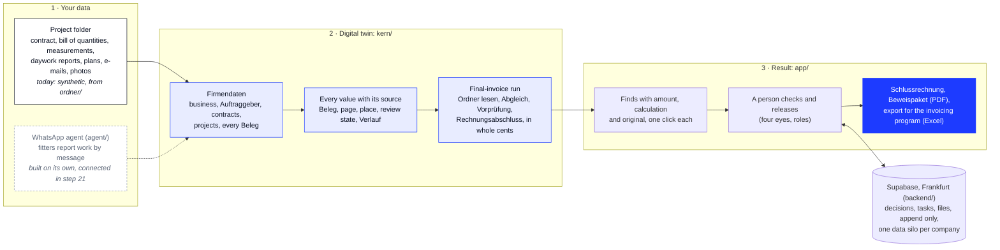

<p align="center">
  
</p>

<h1 align="center">tieout</h1>

<p align="center">
  <b>The digital twin for electrical and MEP contractors. First application: the final invoice.</b><br />
  Started as a hackathon project at WU Vienna (Open Track), now in product development
</p>

<p align="center">
  <a href="https://tieout.at">Website</a> ·
  <a href="https://app.tieout.workers.dev">Demo app</a> ·
  <a href="https://www.linkedin.com/company/tieout-at/">LinkedIn</a>
</p>

---

## Status

- **The demo app is live** at [app.tieout.workers.dev](https://app.tieout.workers.dev), no sign-in: a synthetic building services contractor (Kronfeld Haustechnik) with five projects. Each find (Fund) shows its amount, its calculation and its original documents; a person checks and releases it, and released finds go into the final invoice (Schlussrechnung) with an evidence package. Rebuilt from zero since 23 October 2026 (v2); plan and progress in [`docs/_STATUS.md`](docs/_STATUS.md).
- **The hackathon version (v1)** is archived at [app-v1.tieout.workers.dev](https://app-v1.tieout.workers.dev). Its code is frozen under the tag `v1-archiv` ([app code](https://github.com/tieout-at/tieout/tree/v1-archiv/product/app), architecture and tech stack in the [v1 README](https://github.com/tieout-at/tieout/blob/v1-archiv/README.md#architecture)).

## The problem

On a construction site, more gets built, changed and agreed verbally than ends up on the final invoice: hourly work without a signature, extra quantities, changes ordered by email or WhatsApp. The evidence is scattered across inboxes, plans, photos and people's heads. At the same time, general contractors increasingly check invoices with software and cut whatever lacks evidence.

## What tieout does

**tieout** brings everything a contractor knows together in a **digital twin**: on top, the business (clients, contracts, price base, all projects); below, every project down to the single line item and its evidence. The first application built on it is the **final invoice**: tieout reconciles what was ordered, built and invoiced, and finds what is missing. Every line backed by evidence.

1. **Your data.** Systems (ERP invoices, estimating prices), documents (plans with revision index, bill of quantities, measurements, timesheets) and communication (email instructions, WhatsApp messages, photos, voice notes from the site).
2. **The digital twin.** The business layer (clients, contracts, price base, projects) and the project layer (every line item as ordered, built, invoiced, open). Every value carries its source and a review state; nothing is overwritten.
3. **The result.** A final invoice that finds forgotten hours, extra quantities and plan changes, is pre-checked the way the client would check it, and has evidence for every line. A human decides on every line; nothing is invoiced automatically.

**Principles:** AI delivers facts with a source, a human confirms. The invoice itself is deterministic code. Every number links to its original document. Every business has its own data silo. Synthetic data only until the legal review is complete.

## Architecture



**How it works**

- **`kern/` is the single place where money is computed.** Plain TypeScript without runtime dependencies: it takes `Firmendaten` (whatever a company's setup is, every source ends there), finds what is missing from the final invoice and pre-checks it the way the Auftraggeber would. Amounts are integer cents; every figure is tested to the cent against the solution list [`docs/Demo_Faelle.md`](docs/Demo_Faelle.md).
- **`app/` renders the result.** The pages are built with the figures of `kern/` ahead of time (static export). When someone decides on a find, the same core runs again in the browser over those decisions, so every sum follows at once. PDF and Excel files are written in the browser by small writers of our own.
- **`backend/` keeps what people decide.** Without an account the demo keeps decisions in the browser. With an account (sign-in link by e-mail, invited members only) decisions, tasks and files go to Postgres at Supabase in Frankfurt. The database enforces the rules itself: nothing is changed or deleted, every row belongs to one company, and the person who checked a find cannot also release it. Amounts are never stored; they are always recomputed by `kern/`.
- **`ordner/` builds the test material.** It turns the sample company of `kern/` into real-looking documents (scanned sheets, plans, e-mails) and records where each value sits on the page. The app shows these originals, and every number links to its marked place.
- **`agent/` is the WhatsApp input.** A fitter reports work in a message; Claude reads it and quotes the words each field comes from, code decides whether to ask back or to file it, and the fitter confirms. It runs in a simulator with 60 test scenarios and joins the app in step 21.

**Principles in the code:** AI delivers facts with a source, a person confirms, the invoice itself is deterministic code. History is append only. Each company sees only its own data. All data is synthetic until the legal review is complete.

**Not built yet:** reading a real customer folder with AI (step 18; today the folder is generated, so every value is known in advance), the agent inside the app (step 21), connectors to ERP systems. The plan is in [`docs/_STATUS.md`](docs/_STATUS.md).

### Tech stack

| Part | Built with |
|---|---|
| `app/` | Next.js 16 (static export), React 19, TypeScript, Tailwind 4, shadcn components on Base UI, Lucide icons; Vitest |
| `kern/` | TypeScript, no runtime dependencies; Vitest, about 180 tests against the solution list |
| `backend/` | Supabase (Postgres, Auth, Storage, Realtime) in Frankfurt; SQL migrations with row level security, tested in a local Postgres (PGlite) |
| `ordner/` | TypeScript, pages rendered and measured with the local Microsoft Edge |
| `agent/` | TypeScript, Anthropic SDK (Claude), Zod; simulator and scenario runs with Vitest |
| `website/` | Next.js 16 (static export), one CSS file, German and English |
| Hosting | App on a Cloudflare Worker (Workers Builds: `main` goes live on every merge, every branch gets a preview); website on Cloudflare Pages; GitHub Actions checks every pull request per part (types, lint, tests, build, amount audit) |

## Repository layout

```
.
├── app/        v2 app (Next.js, static export on Cloudflare)
├── kern/       calculation and data model: finds, amounts, evidence, pre-check
├── backend/    database at Supabase (Frankfurt): migrations, row level security, tests
├── ordner/     generator of the synthetic project folder (scans, plans, e-mails) from kern/
├── agent/      WhatsApp agent: fitters report work by text, later voice note or photo; an input of the twin
├── website/    public website tieout.at (Next.js, DE/EN)
├── brand/      logo and LinkedIn graphics, generated by script
└── docs/       status, handover, specification, design, demo cases (solution list)
```

| What | Commands |
|---|---|
| v2 app | `cd app && npm ci && npm run dev` (http://localhost:3100); all checks: `npm run check` |
| Core | `cd kern && npm ci && npm run check` |
| Backend rules (local Postgres) | `cd backend && npm ci && npm run check` |
| Synthetic folder | `cd ordner && npm ci && npm run erzeugen` (needs a local Microsoft Edge) |
| Website | `cd website && npm ci && npm run dev` (http://localhost:3210) |
| WhatsApp agent simulator | `cd agent && npm ci && npm run sim` (http://localhost:4321; needs an API key or a Claude login in `agent/.env`, see [`agent/UEBERGABE.md`](agent/UEBERGABE.md)) |
| v1 app | `git checkout v1-archiv && cd product/app && npm ci && npm run dev` |

Node 22 or newer. Every change goes through a branch and a pull request to `main`; CI checks each part on its own. Working rules: [`CLAUDE.md`](CLAUDE.md).

## Team

| | | |
|---|---|---|
| Maximilian Dieringer | Co-Founder, CEO | [@MaximilianDieringer](https://github.com/MaximilianDieringer) |
| Maximilian Seipl | Co-Founder, COO | [@maxi589](https://github.com/maxi589) |
| Santino Schrader | Co-Founder, CTO | [@Snoft](https://github.com/Snoft) |
| Simon Fuhrbach | Co-Founder, CFO | [@simonfuhrbach-source](https://github.com/simonfuhrbach-source) |

## Rights

Copyright 2026 the tieout team. All rights reserved. The code is public so that it can be read; it is not licensed for use, copying or distribution. All data in this repository is synthetic.
