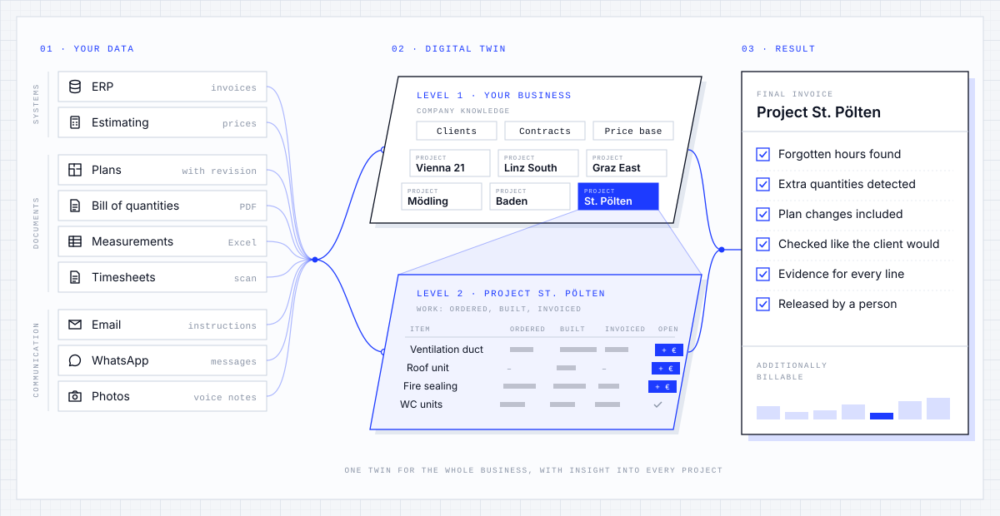

<p align="center">
  
</p>

<h1 align="center">tieout</h1>

<p align="center">
  <b>The digital twin for electrical and MEP contractors. First application: the final invoice.</b><br />
  Started as a hackathon project at WU Vienna (Open Track), now in product development
</p>

<p align="center">
  <a href="https://tieout.at">Website</a> ·
  <a href="https://app.tieout.workers.dev">Demo app</a> ·
  <a href="https://www.linkedin.com/company/tieout-at/">LinkedIn</a>
</p>

---

## Status

- **The demo app is live** at [app.tieout.workers.dev](https://app.tieout.workers.dev), no sign-in: a synthetic building services contractor (Kronfeld Haustechnik) with five projects. Each find (Fund) shows its amount, its calculation and its original documents; a person checks and releases it, and released finds go into the final invoice (Schlussrechnung) with an evidence package. Rebuilt from zero since 23 October 2026 (v2). Today the twin is filled with synthetic data; reading real folders, e-mails and WhatsApp messages with AI comes next. Plan and progress in [`docs/_STATUS.md`](docs/_STATUS.md).
- **The hackathon version (v1)** is archived at [app-v1.tieout.workers.dev](https://app-v1.tieout.workers.dev). Its code is frozen under the tag `v1-archiv` ([app code](https://github.com/tieout-at/tieout/tree/v1-archiv/product/app), architecture and tech stack in the [v1 README](https://github.com/tieout-at/tieout/blob/v1-archiv/README.md#architecture)).

## The problem

On a construction site, more gets built, changed and agreed verbally than ends up on the final invoice: hourly work without a signature, extra quantities, changes ordered by email or WhatsApp. The evidence is scattered across inboxes, plans, photos and people's heads. At the same time, general contractors increasingly check invoices with software and cut whatever lacks evidence.

## The solution

**tieout** brings everything a contractor knows into one **digital twin** of the business: every client, contract and project, down to the single line item and the evidence behind it. The first application built on the twin is the **final invoice**: tieout compares what was ordered, built and invoiced, finds what is missing and backs every line with evidence.

### Architecture

<p align="center">
  
</p>

1. **Input.** Everything a contractor already has, in whatever form it comes: figures from accounting and estimating, documents such as contracts, plans, measurements and timesheets, and what happens on site, from e-mails to WhatsApp messages, photos and voice notes.
2. **Digital twin.** tieout reads these sources and builds one picture of the business: the business on top, every project below it, down to each line item as ordered, built and invoiced. Every value keeps a link to where it came from, and nothing is overwritten.
3. **Output.** The twin shows where money is missing: hours without a signed report, extra quantities, changes ordered by e-mail or on site. It also checks the invoice the way the client would. A person decides on every finding, and the result is a final invoice with evidence for every line.

**Principles:** AI delivers facts with a source, a person confirms, and the invoice itself is calculated by plain, tested code. Every number links to its original. Every business has its own data silo. Only synthetic data until the legal review is complete.

## Repository layout

```
.
├── app/        v2 app (Next.js, static export on Cloudflare)
├── kern/       calculation and data model: finds, amounts, evidence, pre-check
├── backend/    database at Supabase (Frankfurt): migrations, row level security, tests
├── ordner/     generator of the synthetic project folder (scans, plans, e-mails) from kern/
├── agent/      WhatsApp agent: fitters report work by text, later voice note or photo; an input of the twin
├── website/    public website tieout.at (Next.js, DE/EN)
├── brand/      logo and LinkedIn graphics, generated by script
└── docs/       status, handover, specification, design, demo cases (solution list)
```

| What | Commands |
|---|---|
| v2 app | `cd app && npm ci && npm run dev` (http://localhost:3100); all checks: `npm run check` |
| Core | `cd kern && npm ci && npm run check` |
| Backend rules (local Postgres) | `cd backend && npm ci && npm run check` |
| Synthetic folder | `cd ordner && npm ci && npm run erzeugen` (needs a local Microsoft Edge) |
| Website | `cd website && npm ci && npm run dev` (http://localhost:3210) |
| WhatsApp agent simulator | `cd agent && npm ci && npm run sim` (http://localhost:4321; needs an API key or a Claude login in `agent/.env`, see [`agent/UEBERGABE.md`](agent/UEBERGABE.md)) |
| v1 app | `git checkout v1-archiv && cd product/app && npm ci && npm run dev` |

Built with TypeScript, Next.js and Supabase (Frankfurt), hosted on Cloudflare; the WhatsApp agent uses Claude. Node 22 or newer. Every change goes through a branch and a pull request to `main`; CI checks each part on its own. Working rules: [`CLAUDE.md`](CLAUDE.md).

## Team

| | | |
|---|---|---|
| Maximilian Dieringer | Co-Founder, CEO | [LinkedIn](https://www.linkedin.com/in/maximilian-dieringer/) |
| Maximilian Seipl | Co-Founder, COO | [LinkedIn](https://www.linkedin.com/in/maximilian-seipl/) |
| Santino Schrader | Co-Founder, CTO | [LinkedIn](https://www.linkedin.com/in/santino-schrader/) |
| Jack Northwood | Co-Founder, CRO | [LinkedIn](https://www.linkedin.com/in/jack-northwood/) |
| Constantin Dieringer | Co-Founder, Founding Forward Deployed Engineer | [LinkedIn](https://www.linkedin.com/in/constantin-dieringer/) |

## Rights

Copyright 2026 the tieout team. All rights reserved. The code is public so that it can be read; it is not licensed for use, copying or distribution. All data in this repository is synthetic.
