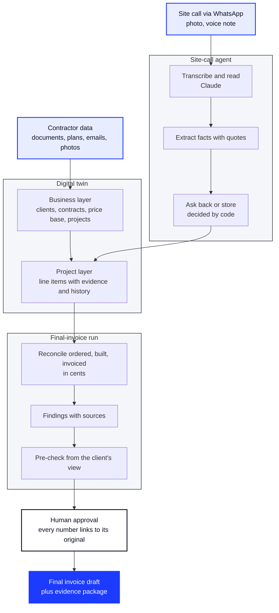

<p align="center">
  
</p>

<h1 align="center">tieout</h1>

<p align="center">
  <b>The digital twin for electrical and MEP contractors. First application: the final invoice.</b><br />
  Hackathon project at WU Vienna, Open Track ([[PLACEHOLDER: exact hackathon name]])
</p>

<p align="center">
  <a href="https://tieout-at.pages.dev">Website</a> ·
  <a href="https://app.tieout.workers.dev">Demo app</a> ·
  <a href="https://www.linkedin.com/company/tieout-at/">LinkedIn</a>
</p>

---

## The problem

On a construction site, more gets built, changed and agreed verbally than ends up on the final invoice: hourly work without a signature, extra quantities, changes ordered by email or WhatsApp. The evidence is scattered across inboxes, plans, photos and people's heads. At the same time, general contractors increasingly check invoices with software and cut whatever lacks evidence.

## What tieout does

**tieout** brings everything a contractor knows together in a **digital twin**: on top, the business (clients, contracts, price base, all projects); below, every project down to the single line item and its evidence. The first application built on it is the **final invoice**: tieout reconciles what was ordered, built and invoiced, and finds what is missing. Every line backed by evidence.

**Principles**

- AI delivers facts with a source, a human confirms.
- The invoice itself is deterministic code, never an estimate.
- Every number links to its original document.
- The twin keeps history, nothing is overwritten. Every business has its own data silo.
- Synthetic data only until the legal review is complete.

## What we built

| Part | What you get | Where |
|---|---|---|
| Product app | the twin of a synthetic contractor with eight projects, findings with original documents, approval flow, calculation core tested to the cent | [app.tieout.workers.dev](https://app.tieout.workers.dev) |
| Site-call agent | WhatsApp agent that turns a fitter's voice note into an entry with a source, with simulator and test scenarios | `product/zuruf/` |
| Website | product story in German and English, interactive twin animation, demo booking | [tieout.at](https://tieout.at) |

## How it works

1. **Data comes in.** The contractor connects or uploads what already exists: bill of quantities, measurements, plans, timesheets, emails, photos. Fitters can also send a quick site call via WhatsApp (photo or voice note).
2. **The twin is built.** Everything is sorted into one model: the business on top (clients, contracts, price base, projects), each project below it, down to the single line item with all its evidence.
3. **The final-invoice run.** For every line item, a deterministic calculation core compares what was ordered, built and invoiced, and turns every gap into a finding with a euro amount and its sources.
4. **A human decides.** Each finding is shown next to its original document. The project lead approves or rejects it; nothing is invoiced automatically.
5. **The result.** Approved findings become additional invoice lines with an evidence package, ready for the final invoice.

## Architecture



### Components

| Component | What it does | Stack | Where |
|---|---|---|---|
| **Product app** (`product/app`) | twin data model, calculation core, screens for findings, ledger, timeline and evidence | Next.js 16, TypeScript, Vitest | Cloudflare Worker, [app.tieout.workers.dev](https://app.tieout.workers.dev) |
| **Site-call agent** (`product/zuruf`) | turns WhatsApp messages into entries with a source | TypeScript, Anthropic SDK (Claude), Zod | simulator, WhatsApp Cloud API |
| **Website** (`website`) | explains the product, demo booking | Next.js 16, static export, DE/EN | Cloudflare Pages, [tieout.at](https://tieout.at) |

**Inside the product app.** The calculation core (`src/engine`) is pure, tested code that works in cents; its results match the reference solution in [`product/docs/Demo_Faelle.md`](product/docs/Demo_Faelle.md) to the cent. A generator provides a synthetic contractor with eight projects; every screen reads through one data-access layer (`src/daten`), so a per-business database plugs in at a single place. Approvals are stored as a history in the browser, including undo.

### How deployment connects everything

1. **GitHub** holds one monorepo with all parts. Every change goes through a pull request.
2. **GitHub Actions** checks the product app on every pull request: types, lint, tests, build.
3. **Cloudflare Workers Builds** rebuilds the product app on every merge to `main` and gives every branch its own preview URL.
4. **A Cloudflare Worker** serves the app's static pages and checks the session first; sign-in runs on Supabase (Frankfurt), invitation only.
5. **Cloudflare Pages** hosts the website; the domain tieout.at runs on Cloudflare DNS.

## Repository layout

```
.
├── README.md            this document
├── CLAUDE.md            working rules, also for AI coding agents
├── _STATUS.md           running status: gates, dates, next steps
├── _UEBERGABE.md        product handover notes
├── product/             the product
│   ├── app/             demo app: Next.js, calculation core, worker
│   ├── zuruf/           site-call agent (WhatsApp), simulator and scenarios
│   ├── ui-fundament/    design system v2 as reference
│   └── docs/            plan, scope, reference solution, review reports
├── website/             public website (Next.js, DE/EN)
├── brand/               logo and LinkedIn graphics, generated by script
└── docs/                strategy, research, archive (internal)
```

Each area has its own README: [`product/`](product/README.md), [`website/`](website/README.md), [`brand/`](brand/README.md), [`docs/`](docs/README.md).

## Run locally

| What | Commands | Address |
|---|---|---|
| Product app | `cd product/app && npm ci && npm run dev` | http://localhost:3000 |
| Website | `cd website && npm install && npm run dev` | http://localhost:3210 |
| Site-call simulator | `cd product/zuruf && npm ci && npm run sim` | see [`product/zuruf/PLAN.md`](product/zuruf/PLAN.md) |

Node 22 or newer. Before every pull request in `product/app`: `npm run typecheck`, `npm run lint`, `npm test`, `npm run build`.

## How we work

- Every change goes through a branch and a pull request to `main`.
- Synthetic data only, never real customer data. No secrets in the repository; keys belong in `.env`.
- No prices or packages in public material until the team has decided on go-to-market.
- Anything not yet known is written as `[[PLACEHOLDER: …]]` and never made up.
- All working rules: [`CLAUDE.md`](CLAUDE.md).

## Team

| | | |
|---|---|---|
| Maximilian Dieringer | Co-Founder, CEO | [@MaximilianDieringer](https://github.com/MaximilianDieringer) |
| Maximilian Seipl | Co-Founder, COO | [@maxi589](https://github.com/maxi589) |
| Santino Schrader | Co-Founder, CTO | [@Snoft](https://github.com/Snoft) |
| Simon Fuhrbach | Co-Founder, CFO | [@simonfuhrbach-source](https://github.com/simonfuhrbach-source) |

