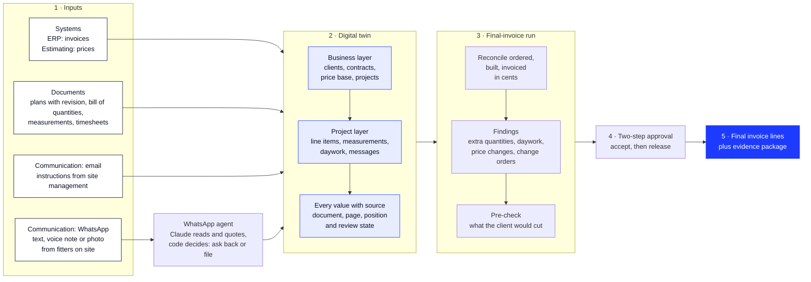

<p align="center">
  
</p>

<h1 align="center">tieout</h1>

<p align="center">
  <b>The digital twin for electrical and MEP contractors. First application: the final invoice.</b><br />
  Hackathon project at WU Vienna, Open Track
</p>

<p align="center">
  <a href="https://tieout-at.pages.dev">Website</a> ·
  <a href="https://app.tieout.workers.dev">Demo app</a> ·
  <a href="https://www.linkedin.com/company/tieout-at/">LinkedIn</a>
</p>

---

## The problem

On a construction site, more gets built, changed and agreed verbally than ends up on the final invoice: hourly work without a signature, extra quantities, changes ordered by email or WhatsApp. The evidence is scattered across inboxes, plans, photos and people's heads. At the same time, general contractors increasingly check invoices with software and cut whatever lacks evidence.

## What tieout does

**tieout** brings everything a contractor knows together in a **digital twin**: on top, the business (clients, contracts, price base, all projects); below, every project down to the single line item and its evidence. The first application built on it is the **final invoice**: tieout reconciles what was ordered, built and invoiced, and finds what is missing. Every line backed by evidence.

**Principles**

- AI delivers facts with a source, a human confirms.
- The invoice itself is deterministic code, never an estimate.
- Every number links to its original document.
- The twin keeps history, nothing is overwritten. Every business has its own data silo.
- Synthetic data only until the legal review is complete.

## What we built

| Part | What you get | Where |
|---|---|---|
| Product app | the twin of a synthetic contractor with eight projects, findings with original documents, approval flow, calculation core tested to the cent | [app.tieout.workers.dev](https://app.tieout.workers.dev) |
| WhatsApp agent | fitters report work from the site by text, voice note or photo; the agent asks back and files a structured entry with its source | `product/whatsapp/` |
| Website | product story in German and English, interactive twin animation, demo booking | [tieout.at](https://tieout.at) |

## How it works

1. **Three kinds of input.** Everything a contractor already has comes in through three groups:
   - **Systems:** ERP (invoices) and estimating software (prices, price base).
   - **Documents:** plans with revision index, bill of quantities (PDF), measurements (Excel), timesheets (scans).
   - **Communication:** instructions by email, and WhatsApp from the site. Fitters send a short text, a voice note or a photo ("socket in room 5 moved, client wanted it, two people, six hours"). An AI agent reads it, asks back once if something important is missing (who ordered it, how long), and files it as an entry with the original message attached.
2. **The digital twin.** All inputs are aggregated into one model: the business on top (clients, contracts, price base, all projects), each project below it, down to the single line item. Every value carries its source and a review state, and nothing is ever overwritten.
3. **The final-invoice run.** A deterministic calculation core reconciles what was ordered, built and invoiced for every line item and turns every gap into a finding with a euro amount and its evidence.
4. **A human decides.** Each finding is shown next to its original document. One person accepts it, a second one releases it; nothing is invoiced automatically.
5. **The result.** Released findings become additional invoice lines with an evidence package, plus a pre-check of what the client is likely to cut.

## Architecture



### Tech stack

| Stage | How it is built |
|---|---|
| **Inputs** | Three channels in the data model: upload of documents (folder), WhatsApp, and connectors to ERP and email. In the demo, a generator (`scripts/generate`) produces a complete synthetic contractor with eight projects as JSON. |
| **WhatsApp agent** (`product/whatsapp`) | TypeScript, Anthropic SDK (Claude) and Zod. The model only reads and quotes; whether to ask back or to file is deterministic code, and replies are fixed German sentences. Runs as an API route inside the app's Cloudflare Worker, with usage limits and append-only storage in Supabase (Postgres, Frankfurt). A browser simulator with test scenarios is used for development. |
| **Digital twin** (`product/app/src/domain`, `src/daten`) | TypeScript data model "record with source": every field is a value plus its source (document, page, position, highlight box) and a review state (machine-read, confirmed, blocked). Amounts in whole cents, percentages in basis points. Hierarchy business → client → project → documents and line items. All screens read through one data-access layer, so a per-business database plugs in at a single place. |
| **Final-invoice run** (`product/app/src/engine`) | Pure TypeScript functions: `pruefe()` builds the context of a project, derives all items (Posten), a ledger across every bill-of-quantities item (shown as LV-Positionen), the cascade and the pre-check; `pruefeFirma()` rolls this up for the whole business. Rounding and money in integer cents, tested with Vitest against a reference solution to the cent. |
| **Approval and screens** (`product/app/src/app`, `src/ui`, `src/zustand`) | Next.js 16 and React 19, static export. Two-step approval stored as a history with undo; every number opens the original document with the source highlighted. |
| **Hosting** | App and WhatsApp agent on a Cloudflare Worker (rebuilt by Workers Builds on every merge), sign-in via Supabase. Website on Cloudflare Pages. GitHub Actions checks every pull request: types, lint, tests, build. |

## Repository layout

```
.
├── README.md            this document
├── CLAUDE.md            working rules, also for AI coding agents
├── product/             the product
│   ├── app/             demo app: Next.js, calculation core, worker
│   ├── whatsapp/        WhatsApp agent, simulator and test scenarios
│   ├── ui-fundament/    design system v2 as reference
│   └── docs/            plan, scope, reference solution, review reports
├── website/             public website (Next.js, DE/EN)
└── brand/               logo and LinkedIn graphics, generated by script
```

Each area has its own README: [`product/`](product/README.md), [`website/`](website/README.md), [`brand/`](brand/README.md).

## Run locally

| What | Commands | Address |
|---|---|---|
| Product app | `cd product/app && npm ci && npm run dev` | http://localhost:3000 |
| Website | `cd website && npm install && npm run dev` | http://localhost:3210 |
| WhatsApp agent simulator | `cd product/whatsapp && npm ci && npm run sim` | see [`product/whatsapp/PLAN.md`](product/whatsapp/PLAN.md) |

Node 22 or newer. Before every pull request in `product/app`: `npm run typecheck`, `npm run lint`, `npm test`, `npm run build`.

## How we work

- Every change goes through a branch and a pull request to `main`.
- Synthetic data only, never real customer data. No secrets in the repository; keys belong in `.env`.
- No prices or packages in public material until the team has decided on go-to-market.
- Anything not yet known is written as `[[PLACEHOLDER: …]]` and never made up.
- All working rules: [`CLAUDE.md`](CLAUDE.md).

## Team

| | | |
|---|---|---|
| Maximilian Dieringer | Co-Founder, CEO | [@MaximilianDieringer](https://github.com/MaximilianDieringer) |
| Maximilian Seipl | Co-Founder, COO | [@maxi589](https://github.com/maxi589) |
| Santino Schrader | Co-Founder, CTO | [@Snoft](https://github.com/Snoft) |
| Simon Fuhrbach | Co-Founder, CFO | [@simonfuhrbach-source](https://github.com/simonfuhrbach-source) |

